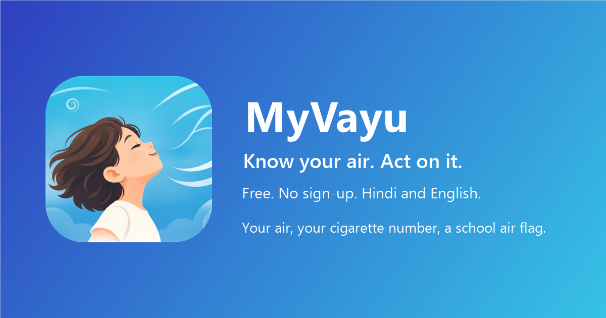

# MyVayu: a free, no-account air quality app for India in English and Hindi, built and launched with AI

Remya Narayanankutty | Founder, product owner

Live at [myvayu.in](https://myvayu.in). MyVayu is an independent project.

## The problem
India's air pollution is a public health problem that most people cannot see or measure. Official numbers use a scale and colour names that mean little at a glance, and most tools ask for sign-ups or fill the screen with ads.

I wanted a tool anyone could use in ten seconds: free, no account, in English and Hindi, safe to use, and honest about what the numbers mean. The first goal was awareness. I also wanted it to cost nothing to run, so it could stay alive without funding.

## What I built
A single web page that works like an app and installs to the phone's home screen.

- Today's air for any place, from modelled estimates, on the US AQI scale that most air quality apps show.
- A plain-language level with an icon and one sentence on what it means for people.
- A cigarette-equivalent number, as a way to make the particle level easy to feel, with the method shown and a clear note that it is a rough comparison.
- A world ranking against the 150 largest cities.
- A school air flag poster, a pollution report, and ready-to-send letters to a school, a housing society or a local representative.
- A daily log that fills in on the phone.

There are no accounts, no ads, and no server of my own holding personal data.

## How it works
**Design.** The app is one static file hosted on Cloudflare Pages from a private GitHub repository. Air data comes from a free public weather and air quality service. Everything the user saves, such as the log, the chosen place and saved letters, stays in the phone's own storage.

**Honest by design.** In clean air, the app shows no cigarette counts and switches to a "keep it clean" version of the letters and the effects page. A page headed "acceptable air" that listed lung cancer and heart failure was wrong, so those lines show only where the air is actually polluted.

**Safe by design.** The site has a strict content security policy and security headers. Location is rounded to about one kilometre before it is used. The privacy page says exactly what leaves the phone and what does not.

## How I built it
I worked with an AI coding assistant as a build partner, in short loops. For each change the assistant proposed options, showed them visually, built the chosen one, and measured the result in a phone-sized browser before I saw it.

- **Naming and look.** I chose the name, the colours and the logo direction. The assistant generated options and redrew them until they worked at small size.
- **Making numbers understandable.** Official category names read alike. I replaced them with six plain words and icons, Clean, Acceptable, Caution, Unhealthy, Dangerous and Hazardous, each with a one-line meaning.
- **Fitting a phone screen.** The first cigarette card was taller than a whole phone screen. I asked for it to be redesigned, and it went from about 890 pixels to about 290. The same pass shortened the AQI card and tightened the page so the key number sits on the first screen.
- **Sources over memory.** The first world ranking used a list of cities the assistant picked from memory. I asked how they had been chosen, the honest answer was "by judgment", and I had them replaced with the United Nations list of the 150 largest cities, with every coordinate taken from the source file.

## QA testing
Before launch the app was reviewed by a separate reviewer working only from a written brief that I prepared with the assistant. The brief told it to read the code, run every critical flow on desktop and phone widths, try to break the app, review security and check data integrity. It could not change any code, and it had to separate confirmed defects, each with steps to reproduce and the line of code, from mere suspicions.

The review produced two rounds of fixes, ten defects in all, plus a third group found along the way:

- The log started before a place was chosen, and then filled with the wrong place's history.
- Reopening the app could show an hour-old reading.
- The language switch was clipped on small screens, and Hindi search did not find places by their Hindi names.
- A failed load left the previous place's ranking and effects on screen.
- The share image overflowed its disclaimer on the most polluted days.
- "Best and worst hours" ignored the place's own time zone.
- An empty reply from the data service could be cached and block a place for an hour.
- Saved letters were duplicated, and a blocked or full phone storage failed silently.

Each round went in as a separate change with a plain description of every fix, so the repository history reads as an audit trail.

## What went wrong and what I changed
- **A number that did not match the apps people trust.** I checked Mumbai against IQAir. My app showed 98 in light green, and IQAir showed 157. The air data agreed within a few percent. The difference was the scale (mine used India's official bands and a 24-hour average) and the time window (IQAir shows the current hour). I had the assistant research which scale leading platforms use, and I decided the app must show one number that people can verify elsewhere. It now uses the US scale on the latest hour, and Mumbai reads the same as IQAir.
- **A claim that was not true.** The footer said location was rounded, but the app sent exact coordinates. The assistant flagged it while we rewrote the text. We fixed the code first, and then kept the sentence.
- **A promise I could not keep.** "We do not track you" came out of the footer once I added visit counting. The privacy text now says only what is true.
- **Content that contradicted itself.** Clean air showed long-term illness lists. I rebuilt that page for clean air.
- **Icons that did not communicate.** The top three levels went through four rounds. A skull, a smog cloud and a gas mask were each rejected. I now show options large and at real size before applying one, and the siren was the one that worked.
- **A contact address that vanished.** The hosting provider rewrote my email address on the privacy page into "[email protected]" and the restoring script was blocked by my own security policy. The link is now built in the browser.
- **Tooling slips.** One style rule resized every icon in a card because it was too broad. Another edit failed because the file used Windows line endings. Measuring the real page found both.

## How AI was used
- **Pattern:** a build loop with me as product owner. The assistant proposes, builds and measures. I decide.
- **Autonomy:** the assistant writes and tests code, drafts copy in two languages, designs icons and generates the privacy text. It stops before anything that touches an account or the public.
- **Guardrails:** a private repository, a read-only reviewer who could not change code, strict security headers, and a rule that every health or privacy statement must match what the code does.
- **Human checkpoints:** I approved every design, every wording choice, each data source, and every push to the live site. I created the domain, hosting and email accounts myself. The assistant never held a password.
- **How it improved:** an independent review found defects the builder missed. My questions, such as "how did you choose these cities?", pushed the work from convenient to defensible.
- **My role:** I set the principles, which were privacy first, no accounts, one number people can check against other apps, and honesty over drama. I chose the names, the icons, what to show and hide, and when to launch.

## What I would do next
Add offline support, a small hourly data job so a busy day cannot overwhelm the data service, and an Android listing. I will add results here once there is enough real usage to say something meaningful.
